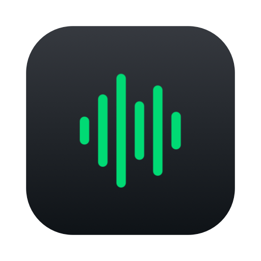

<p align="center"></p>

# SpotSelector

**Change Spotify's sound quality from your Mac's menu bar, in one click.**


## What it does

SpotSelector puts a small icon in your Mac's menu bar showing the quality Spotify is streaming at, such as Lossless or Very High. Click it, pick another quality, and Spotify switches. You never have to dig through Spotify's settings.

## How it does it

Spotify keeps its quality choice in a small settings file on your Mac, and it only reads that file when it starts up. So when you pick a new quality, SpotSelector closes Spotify, changes that single setting, opens Spotify again and carries on playing your song from where you left off. The whole switch takes a few seconds.

It changes nothing else. It keeps a backup of Spotify's settings before every change, and if anything looks unexpected it stops and tells you instead of guessing.

## Why it matters

The best quality isn't always the right quality:

- **Lossless sounds best, but it uses much more data.** That's great at your desk with good speakers, and wasteful on a phone hotspot, on a train or with a weak connection.
- **Bluetooth headphones like AirPods can't play true lossless over Bluetooth**, so streaming it to them gains you little.
- **Spotify buries this setting** a few screens deep, so it's easy to set once and forget, even when it no longer suits where you are.

SpotSelector makes it as easy to change as your volume.

## Download

### [⬇ Download SpotSelector for Mac](https://github.com/andresurena/SpotSelector/releases/latest/download/SpotSelector.zip)

Unzip it and drag **SpotSelector** into your Applications folder. ([All releases](https://github.com/andresurena/SpotSelector/releases/latest))

You'll need:

- macOS 14 Sonoma or later (Apple Silicon or Intel)
- The Spotify desktop app
- Spotify Premium for Very High and Lossless (Lossless only in countries where Spotify offers it)

### The first time you open it

- **macOS will say it can't check the app.** That's because this free app isn't registered with Apple's paid notarisation service yet, not because something is wrong with it. Try opening it once, then go to **System Settings → Privacy & Security**, scroll down and click **Open Anyway**. You only need to do this once.
- **It starts itself when you log in**, so it's always in your menu bar. You can turn this off under **Options → Launch at Login**.
- **The first time you switch while music is playing**, macOS asks whether SpotSelector may control Spotify. Click **Allow** so it can resume your song. If you decline, switching still works, but you'll need to press play yourself.

In the menu, **Options → Show in Menu** lets you hide the qualities you never use, so only your two or three favourites appear.

---

## The technical part

*Everything below is for developers and the curious. You don't need any of it to use the app.*

### How it works in detail

Spotify stores the streaming-quality dropdown in a plain-text prefs file:

```
~/Library/Application Support/Spotify/Users/<username>-user/prefs
audio.play_bitrate_enumeration=5
audio.play_bitrate_non_metered_enumeration=5
```

Values: `0` Automatic, `1` Low, `2` Normal, `3` High, `4` Very High, `5` Lossless. These match the quality enum in the Spotify 1.3 desktop client.

Spotify reads this file at launch and rewrites it when it quits, so editing it while Spotify runs has no effect. A switch is: ask Spotify to quit, edit the two lines, relaunch Spotify, then restore the track and position over AppleScript. If Spotify isn't running, the file is simply edited.

### Safeguards

- Nothing is written until Spotify has fully quit (15-second timeout; Spotify is never force-killed).
- Only the quality lines are touched; the rest of the file is preserved byte for byte.
- The previous prefs file is copied to `~/Library/Application Support/SpotSelector/Backups/prefs.backup` before every write.
- The write is atomic, re-read to verify, and rolled back from the backup on mismatch.
- If the file holds a quality value the app doesn't recognise, it refuses to write.
- Spotify is reopened even if the write fails.

These prefs keys are undocumented. A Spotify update could change them; the app will then show an error rather than guess.

### Signing

Release builds are signed with an Apple Development certificate but not notarised, which is why Gatekeeper asks you to approve the app the first time. Building from source avoids the prompt entirely.

### Build from source

Requires Xcode (or its command line tools) and macOS 14+.

```bash
./scripts/build-app.sh             # builds build/SpotSelector.app (universal)
./scripts/build-app.sh --install   # also copies it to /Applications and launches it
./scripts/package-release.sh       # builds and zips build/SpotSelector.zip
swift test
```

`scripts/make-icon.swift` regenerates `Resources/AppIcon.icns` and the README icon `Resources/AppIcon-preview.png`.

The first run from `/Applications` registers SpotSelector as a login item (via `SMAppService`); runs from the build folder don't, so the login item never points at a throwaway copy.

### Command line

The same binary works headless, for scripts, Shortcuts or Raycast:

```bash
"/Applications/SpotSelector.app/Contents/MacOS/SpotSelector" --get
"/Applications/SpotSelector.app/Contents/MacOS/SpotSelector" --set very-high
"/Applications/SpotSelector.app/Contents/MacOS/SpotSelector" --set lossless --no-resume
```

### Project layout

- `Sources/QualityCore`: prefs parsing and safe file writing (unit tested)
- `Sources/SpotSelector`: menu bar UI, Spotify quit/relaunch/resume, command-line mode
- `Resources/Info.plist`: bundle metadata (`LSUIElement` hides the Dock icon)
- `scripts/`: build, packaging and icon generation

## Licence

MIT. See [LICENSE](LICENSE).

SpotSelector is an independent project and is not affiliated with, endorsed by or connected to Spotify.
